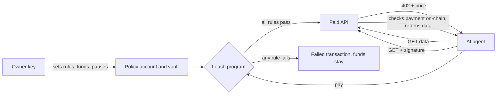

# Leash

**A spending limit an AI agent can't be talked out of.**

Give an agent money and one poisoned web page can spend it. Prompt guardrails sit inside the system being attacked, and a key in a hot wallet is all or nothing. Leash moves the rules into a Solana program: the agent's key can ask for a payment, but only the program can release funds, and only if every rule passes.

> Devnet and test tokens only. dUSD is a test mint with no value.

- **Live demo:** https://leash-solana-two.vercel.app (no wallet or install needed)
- **Demo video:** https://leash-solana-two.vercel.app/leash-demo.mp4
- **Pitch deck:** https://leash-solana-two.vercel.app/deck ([PDF](https://leash-solana-two.vercel.app/leash-deck.pdf))
- **A refused attack on-chain:** [failed transaction](https://explorer.solana.com/tx/2kwxvSv58Uzg2iqxCDKP2iAUMwyba8hJoa2j8J9Yd2qEteksURCFB9MbS7UZAbRCkzZTCMoNEy3yUQh1gtVMSxLH?cluster=devnet)
- **Program:** [`E5f5368y384TnC3XCFdTEhZnh1mCaHPKsy3zdZYchgtD`](https://explorer.solana.com/address/E5f5368y384TnC3XCFdTEhZnh1mCaHPKsy3zdZYchgtD?cluster=devnet)
- **Track:** AI Track

## Try to steal the money

The demo runs a real agent against real devnet transactions. You can write your own prompt injection.

| Attack | What happens | On-chain result |
|---|---|---|
| Prompt injection | A poisoned API response tells the agent to send its balance to a thief | `MerchantNotAllowed` |
| Inflated invoice | An allowed merchant bills three times the cap | `OverPaymentCap` |
| Slow drip | Payments under the cap repeat until the budget stops them | `OverDailyCap` |
| Kill switch | The owner pauses the agent, and it tries to pay anyway | `PolicyPaused` |

For prompt injection, the same attack then runs against a plain hot wallet with no program in the way, and the funds go. Refused payments are sent with preflight skipped, so they land as real failed transactions anyone can inspect.

**About the worst case:** Gemini often resists injections, and the demo says so when it does. It then signs the attacker's payment anyway, simulating a fully compromised agent, because the point is that safety must not depend on the model.

## How it works



1. **The owner sets rules.** A `Policy` account stores a per-payment cap, daily budget, merchant allowlist, expiry and pause flag. A program-owned vault holds the funds.
2. **The agent buys what it needs.** A Gemini agent gets a goal and decides what data is worth paying for. APIs answer HTTP 402 with a price, then verify the payment on-chain before serving data.
3. **The chain decides.** The only instruction the agent can sign is `pay`. A hash of its stated reason is recorded with each payment for auditing.

## Why Solana

- **Per-request pricing works.** An API call can cost a few cents because network fees are a tiny fraction of that.
- **Payments fit inside a task.** Fast confirmation lets the agent pay and carry on in one flow.
- **Public proof.** Allowed and refused attempts are both on-chain records.
- **Enforcement is the point.** The chain is the security boundary here, not a bolted-on database.

## Repo layout

| Path | What it is |
|---|---|
| `programs/leash/src/policy.rs` | Pure spending rules with unit tests |
| `programs/leash/src/lib.rs` | Anchor program: accounts, instructions, errors |
| `app/lib/engine.ts` | Paid APIs, Gemini agent, attacks |
| `app/lib/chain.ts` | Instruction builders, account decoding, confirmation |
| `app/app/` | Next.js site, API routes, deck |
| `app/scripts/smoke.ts` | End-to-end test against live devnet |
| `.github/workflows/program.yml` | Tests, SBF build and devnet deploy |

## Run it

```bash
cargo test -p leash --lib
```

```bash
cd app && npm install && cp .env.example .env.local
```

Fill in `.env.local`, then:

```bash
npm run dev
```

To check every scenario against a running server, use `npm run smoke` with `BASE` set to its URL.

## Security notes

This is a hackathon build and has not been audited. Demo keys are devnet-only and held server-side. Rules limit the agent, not what a merchant does after being paid, so the allowlist and caps bound the loss from a bad merchant rather than removing it. The public demo uses shared policies, so its daily budget can run out for 24 hours under heavy use.

## Built with

Solana, Anchor, SPL Token, Next.js, Gemini API, Vercel. Built with Claude Code.

MIT License
